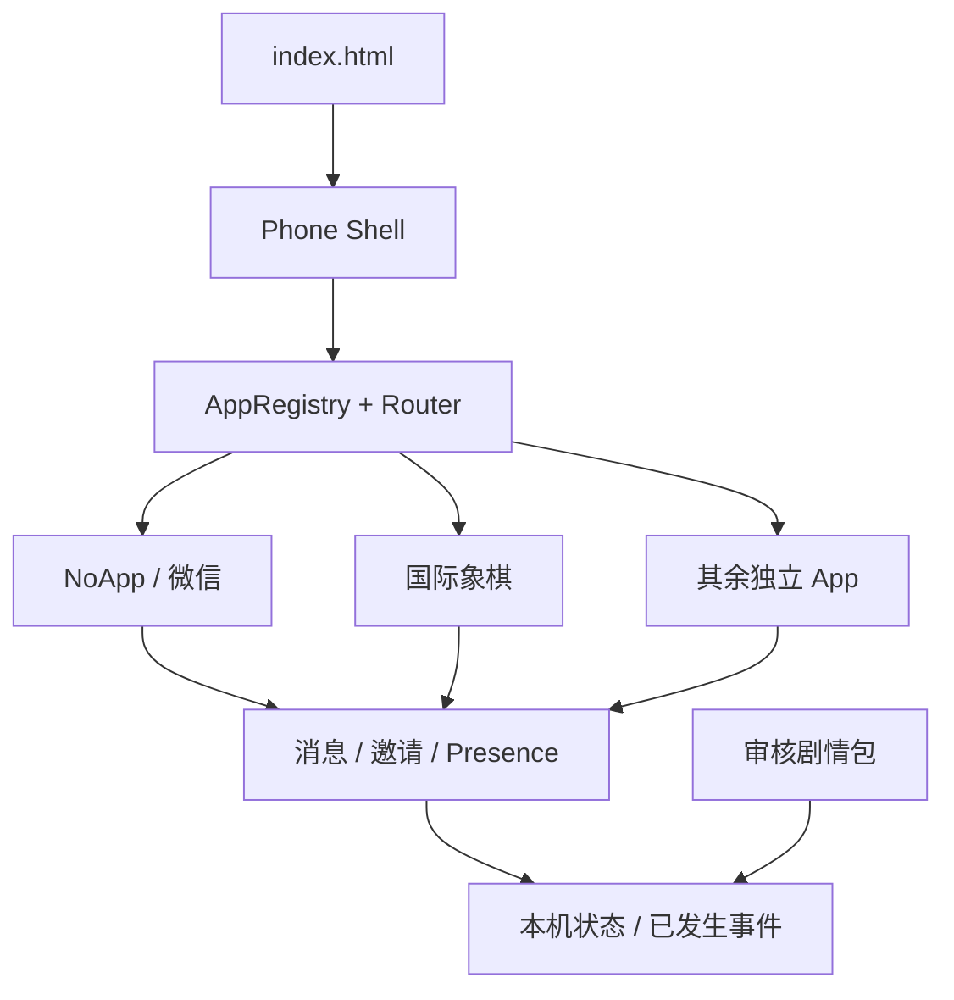

# Phone Framework · 架构与验收

## 系统边界

`index.html` 载入 `src/main.js`。`PhoneStore` 持有已发生的手机状态；`PhoneRouter` 管理 `{appId, route, params}` 和返回栈；`AppRegistry` 将独立 App 模块注册到桌面。Shell 常驻，只替换 App 画面。App 从服务读取状态和事件，不把正式剧情写进界面组件。

## 国际象棋邀请

- 入站演示邀请只从 `src/story/demo/seed.js` 装载。`receiveInvitation()` 校验来源、到期日和状态；重复点击返回既有 `matchId`。
- 出站邀请创建唯一 ID，写入事件；统一 Presence 状态为 `busy`、`away` 或 `offline` 时保持待回应。本地演示规则仅在 `online` 时接受一次，生成可点击通知。真实角色决定及延迟回复属于后续 AI/剧情模块。
- 棋局用 `chess.js` 验证走子，每一步立即保存 PGN 与事件。离开 App 不计时、不判负；重新打开或刷新时从 PGN 恢复。黑方当前由可识别的基础规则对手执行一步，不代表熙泰的真实棋力。
- AI 可见事实仅来自已发生事件；`src/services/ai/facts.js` 不包括未来日期或演示 fixture。正式版还需服务器权限过滤。

## 内容编辑与服务接入

`src/story/schemas/content.schema.json` 定义独立内容事件格式。正式文案按日期、场景、渠道拆分；只有 `reviewStatus: approved` 的内容包可由剧情加载接口接纳。浏览器编辑器目前只写本机状态，不会直接改 Git 文件或上线内容。Supabase 适配层位于 `src/services/supabase/`；MiniMax 适配层位于 `src/services/voice/`，旧服务端代理草案归档在 `src/legacy/`，不可直接部署。未配置密钥、登录、审核与服务端授权时保持未连接。

## 验收清单

| 项目 | 状态 |
| --- | --- |
| 单入口、Shell、25 个 App 独立注册与目录 | 已实现 |
| NoApp → 邀请 → 棋盘 → 返回聊天 | 已实现，DEMO 内容 |
| 棋盘合法走子、棋局保存、刷新恢复 | 已实现；黑方基础规则模拟 |
| 玩家主动邀请、忙碌/离线待回应、在线通知 | 已实现；回应是本机演示规则 |
| 开发者修改对话、图片、壁纸、图标与日期 | 已实现，本机草稿 |
| Supabase 登录、云同步、服务端邀请验证 | 未接入，接口预留 |
| MiniMax 语音与实时电话 | 未接入，接口预留 |
| 正式 90 天文案与真实 AI 对弈 | 未接入，等待审核内容与独立模块 |

运行 `npm test` 验证注册、邀请幂等、在线状态、棋局走子与恢复；`npm run build` 产出静态部署目录。
